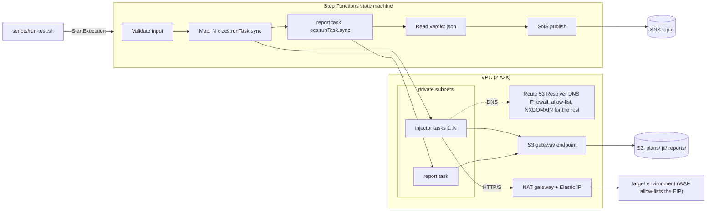

# fargate-jmeter-runner

[](https://github.com/rahulkumar96t/fargate-jmeter-runner/actions/workflows/ci.yml)

Distributed Apache JMeter load tests on AWS ECS Fargate, orchestrated by Step Functions
and defined in Terraform. A run fans out N injector tasks that start in step, run the
same plan, and upload raw results to S3. A final task merges the results into
JMeter's HTML dashboard and a pass/fail verdict (`p95>800`, `errors>1%`), and SNS
sends the outcome. All injector traffic leaves through one NAT gateway with a
dedicated Elastic IP, so the target's WAF can allow-list a single address. A Route 53
Resolver DNS Firewall lets the VPC resolve only the target domains and the AWS
endpoints the tasks need, so a plan pointed at the wrong environment fails at DNS
lookup.

## Features

- **Terraform root module** (`terraform/`): VPC over 2 AZs, one NAT gateway with an
  Elastic IP, `nat_enabled` toggle, DNS firewall allow-list, ECR, ECS cluster, a
  `jmeter` task definition, S3 bucket with lifecycle rules, CloudWatch logs, SNS, IAM
  roles scoped per step, and the state machine rendered from an ASL template.
- **Per-run sizing**: injectors are `S`/`M`/`L`/`XL`; each size is a Fargate CPU/memory
  pair validated against the Fargate table. Task CPU and memory are overridden per run.
- **Input checked before anything is started**: injector count, duration, threads,
  ramp-up, size, plan key and target host (against the same allow-list as the DNS
  firewall) are validated inside the state machine.
- **Synchronised start**: injectors wait until `execution start + injector_start_delay_seconds`,
  so tasks that took longer to provision do not skew the load profile.
- **Report and verdict**: `tools/jtl_summary.py` (standard library only) merges JTL
  files and computes count, error %, avg, p50/p90/p95/p99 and throughput per label and
  overall. It writes `summary.json` and a small `verdict.json` that the state machine
  reads to decide between "passed" and "failed its checks".
- **Docker image**: Temurin 21 JRE, JMeter 5.6.3 checked against the Apache SHA-512,
  the Plugins Manager pinned by SHA-256, plugins from a pinned list, non-root user,
  read-only root file system.
- **`scripts/run-test.sh`**: validates arguments, builds the execution input, starts the
  run and optionally waits for the result.

## Architecture



### How a run works

1. `run-test.sh` starts an execution. The execution name is the **run id**; it keys
   every S3 prefix of the run.
2. `LoadDefaults` and `MergeInput` merge the input over the module's defaults, then
   apply fixed values the caller cannot override (for example whether egress exists).
3. `Validate` rejects bad input before any task starts. Rejections go through the
   failure notification like any other error.
4. `ResolveSize` maps `S|M|L|XL` to Fargate CPU/memory strings.
5. `RunInjectors` (inline Map, `MaxConcurrency = max_injectors`) runs one
   `ecs:runTask.sync` per injector with container overrides (command `run`, CPU,
   memory, environment). RunTask API errors are retried with jitter. A task that fails
   mid-test is **not** retried; the iteration records the failure and the Map continues.
6. `BuildReport` runs the same image with command `report`, the reporter role and
   `report_size`.
7. `LoadVerdict` reads `reports/<run-id>/verdict.json` (bounded size, unlike
   `summary.json`) and `CheckVerdict` routes to "passed" or "failed its checks".
8. Every outcome publishes to SNS. The execution ends `Succeeded`, `VerdictFailed`
   (thresholds breached or injector results missing) or `Failed` (anything else, with
   the original error name).

### S3 layout

| Prefix | Content | Retention |
|---|---|---|
| `plans/<folder>/<plan>.jmx` | Test plans and their CSV data files | kept |
| `jtl/<run-id>/injector-<n>.jtl` | Raw samples, plus `logs/jmeter-<n>.log` | `jtl_retention_days` (14) |
| `jtl/<run-id>/injector-<n>.jtl.partial` | Results of an injector that failed; not merged | `jtl_retention_days` |
| `reports/<run-id>/` | `index.html` dashboard, `summary.json`, `verdict.json` | `report_retention_days` (365) |

S3 lifecycle filters match a key prefix, tags or object size, not a folder in the
middle of a key. That is why raw results and reports live under different top-level
prefixes instead of one folder per run.

## Quickstart

Prerequisites: Terraform >= 1.9, AWS CLI v2, Docker with Buildx, credentials for the
target account.

**1. Build the image** (from the repository root):

```bash
docker build -f docker/Dockerfile -t jmeter-runner:5.6.3 .
```

**2. Apply the infrastructure.** Start from `examples/minimal` or call the module:

```hcl
module "jmeter" {
  source = "github.com/rahulkumar96t/fargate-jmeter-runner//terraform"

  name           = "acme-perf"
  target_domains = ["perf.example.com", "*.perf.example.com"]
}
```

```bash
cd examples/minimal
terraform init && terraform apply
terraform output egress_ip   # give this address to whoever owns the target's WAF
```

**3. Push the image** to the repository the module created:

```bash
REPO=$(terraform output -raw ecr_repository_url)
aws ecr get-login-password | docker login --username AWS --password-stdin "${REPO%%/*}"
docker tag jmeter-runner:5.6.3 "$REPO:5.6.3"
docker push "$REPO:5.6.3"
```

Tags are immutable. For a rebuilt image push a new tag (`5.6.3-2`) and set `image_tag`.

**4. Upload a plan and run a test:**

```bash
export JMETER_STATE_MACHINE_ARN=$(terraform output -raw state_machine_arn)
export JMETER_RESULTS_BUCKET=$(terraform output -raw results_bucket)

../../scripts/run-test.sh \
  --upload ../../plans/smoke/smoke.jmx -p plans/smoke/smoke.jmx \
  -t perf.example.com -n 4 -s M -u 50 -r 60 -d 600 \
  --fail-if 'p95>800' --fail-if 'errors>1%' --wait
```

The report is at `s3://<bucket>/reports/<run-id>/index.html`
(`aws s3 sync s3://<bucket>/reports/<run-id>/ ./report/` to open it locally).

**5. Between campaigns**, remove the NAT gateway and keep the address:

```bash
terraform apply -var nat_enabled=false   # the Elastic IP stays allocated
```

Runs started while `nat_enabled = false` are rejected by the state machine with
`RejectEgressDisabled` instead of failing later on image pull.

## Usage

### Execution input

`run-test.sh --dry-run` prints the document it would send. Any client can start an
execution with the same JSON:

```bash
aws stepfunctions start-execution \
  --state-machine-arn "$JMETER_STATE_MACHINE_ARN" \
  --name checkout-2026-11-11 \
  --input '{"plan":"plans/checkout/checkout.jmx","targetHost":"perf.example.com",
            "injectors":8,"size":"L","threads":250,"rampUpSeconds":120,
            "durationSeconds":1800,"thresholds":"p95>800,errors>1%",
            "properties":"think.ms=500"}'
```

| Field | Default | Rule |
|---|---|---|
| `plan` | required | S3 key matching `plans/*.jmx` |
| `targetHost` | required | must match an entry of `target_domains` |
| `injectors` | 1 | 1..`max_injectors` (at most 40) |
| `size` | `default_injector_size` | `S`, `M`, `L` or `XL` |
| `threads` | 10 | per injector, 1..`max_threads_per_injector` |
| `rampUpSeconds` | 60 | 0..`durationSeconds` |
| `durationSeconds` | 300 | 60..`max_duration_seconds` |
| `targetProtocol`, `targetPort` | `https`, 443 | `http`/`https`, 1..65535 |
| `thresholds` | `default_thresholds` | comma-separated, e.g. `p95>800,errors>1%,rps<50` |
| `properties` | empty | extra JMeter properties, `key=value,key=value` |

Threshold metrics: `count`, `errors` (percent), `avg`, `min`, `max`, `p50`, `p90`,
`p95`, `p99` (milliseconds), `rps`. Operators: `>`, `>=`, `<`, `<=`. A threshold
describes the failure condition and is checked against the overall statistics.

### Writing a plan

The entrypoint passes these JMeter properties; read them with `${__P(name,default)}`
(see `plans/smoke/smoke.jmx`):

| Property | Source |
|---|---|
| `target.protocol`, `target.host`, `target.port` | `targetProtocol`, `targetHost`, `targetPort` |
| `threads`, `rampup`, `duration` | per-injector thread group shape |
| `injector.index`, `injector.count` | 0-based index and number of injectors |
| `run.id` | the execution name (useful in a header so the target can identify the traffic) |
| anything in `properties` | `-Jkey=value` |

`threads` is **per injector**: `-n 4 -u 250` produces 1000 virtual users. Keep each plan
in its own folder; the folder is downloaded, so CSV data sets next to the plan work
with relative paths.

### Container contract

The image's entrypoint takes `run` or `report` and reads its settings from the
environment. The state machine sets these as container overrides; they are also what
you set to run the image by hand.

| Variable | Mode | Meaning |
|---|---|---|
| `RESULTS_BUCKET` | both | bucket name (set in the task definition) |
| `RUN_ID` | both | run id; `[A-Za-z0-9_-]{1,80}`, so it cannot escape its prefix |
| `PLAN_KEY` | run | `plans/<folder>/<plan>.jmx`; the whole folder is downloaded |
| `TARGET_HOST`, `TARGET_PROTOCOL`, `TARGET_PORT` | run | passed as `target.*` properties |
| `THREADS`, `RAMP_UP_SECONDS`, `DURATION_SECONDS` | run | thread group shape |
| `INJECTOR_INDEX`, `INJECTOR_COUNT` | run | position of this injector |
| `START_AFTER`, `START_DELAY_SECONDS` | run | ISO-8601 time plus delay to wait for |
| `JMETER_PROPERTIES` | run | `key=value,key=value`, forwarded as `-Jkey=value` |
| `JMETER_GRACE_SECONDS` | run | extra time before JMeter is killed (default 300) |
| `EXPECTED_INJECTORS`, `FAIL_IF` | report | result files to expect; thresholds |

`run` uploads `jtl/<run-id>/injector-<n>.jtl` only when JMeter exited 0 and recorded
samples; otherwise it uploads `.jtl.partial` and exits 1. On SIGTERM (ECS `StopTask`) it
stops JMeter and uploads what was recorded. `report` exits 0 whether or not the checks
pass; it exits non-zero only when it cannot produce a report.

### The summary tool on its own

```bash
python3 tools/jtl_summary.py results/*.jtl --merged-out merged.jtl \
  --out summary.json --verdict-out verdict.json --fail-if 'p95>800,errors>1%'
```

Exit codes: 0 passed, 1 a check failed (or fewer files than `--expect-inputs`), 2 bad
input. Percentiles use the nearest-rank method, so every reported value is an observed
sample; JMeter's dashboard interpolates, so single labels can differ in the last digit.

## Injector sizes and cost

| Size | vCPU / memory | x86_64 per hour | ARM64 per hour |
|---|---|---|---|
| S | 1 / 4 GiB | ~$0.058 | ~$0.047 |
| M | 2 / 8 GiB | ~$0.117 | ~$0.093 |
| L | 4 / 16 GiB | ~$0.233 | ~$0.186 |
| XL | 8 / 32 GiB | ~$0.466 | ~$0.373 |

These are **approximate us-east-1 list prices** (Fargate on-demand: about $0.0405 per
vCPU-hour and $0.0044 per GB-hour on x86_64, about 20 % less on ARM64), computed by
hand, not measured bills. Check the AWS pricing pages for your region before relying
on them. Other costs to know about:

- **NAT gateway**: about $0.045 per hour (roughly $33 per month if left running) plus
  about $0.045 per GB processed. Request *and* response bytes of the load test pass
  through it, so a test that downloads 500 GB adds roughly $22. This is why
  `nat_enabled` exists.
- **Elastic IP**: public IPv4 addresses cost about $0.005 per hour (about $3.65 per
  month) whether attached or not. Keeping it is the price of a stable allow-listed IP.
- Ephemeral storage above 20 GiB (default 50 GiB per task), CloudWatch Logs, S3 and
  Step Functions transitions are small next to the above.
- The S3 gateway endpoint is free and keeps JTL uploads and ECR layer downloads off
  the NAT gateway.

Memory is set at 4 GiB per vCPU because JMeter usually runs out of heap before CPU.
`HEAP` uses `-XX:MaxRAMPercentage=75`, so the heap follows the size chosen per run.
Override `injector_sizes` for other ratios; invalid Fargate pairs fail validation.

## Safety

- **DNS allow-list.** The VPC resolves only `target_domains`, `extra_allowed_domains`
  and the endpoints the tasks need (ECR API and the account's registry, regional S3,
  CloudWatch Logs, STS, the VPC's own host names). Everything else gets NXDOMAIN, and
  the firewall fails closed. Broad names such as `*.amazonaws.com` are deliberately
  not on the list: they would admit other environments' load balancers and API
  endpoints. Allowed targets trust their CNAME chain, so a target behind a CDN or load
  balancer resolves without allow-listing the provider's whole domain.
- **Second check in the state machine.** `targetHost` is matched against the same
  patterns before any task starts, so a wrong host fails in seconds without starting
  a Fargate task.
- **One egress address.** All injectors use one NAT gateway and its Elastic IP. The EIP
  is not tied to `nat_enabled`, so toggling never changes the address (a Terraform
  test applies on, off and on again and asserts the allocation id stays the same).
- **Least privilege.** Injectors read `plans/` and write `jtl/` only. The reporter reads
  `jtl/` and writes `reports/` only. The state machine may run only this task
  definition family on this cluster, pass only these roles, and read only
  `verdict.json`. The execution role is narrower than `AmazonECSTaskExecutionRolePolicy`.
  Every trust policy pins `aws:SourceAccount`.
- **Container.** Non-root user, read-only root file system with `/work` (task storage)
  as the only writable path, no inbound security group rules, no public IPs.

## Design decisions and trade-offs

- **One NAT gateway, not one per AZ.** A single egress IP is the point. The cost is a
  cross-AZ hop for half of the injectors and no egress if that AZ fails, which is
  acceptable for a test harness.
- **Inline Map, at most 40 injectors.** An inline Map runs at most 40 iterations
  concurrently. Injectors beyond that would start only after others finished, which
  silently changes the load, so `max_injectors` is capped at 40. A Distributed Map
  would lift the cap at the cost of a more complex definition.
- **Failed injectors are not retried.** A restart minutes later would add load at the
  wrong time. The iteration records the failure, the others continue, and the verdict
  fails with "only N-1 of N injector result files present". Partial results are kept as
  `.jtl.partial` for diagnosis but are not merged.
- **Threshold breach is a result, not an error.** The report task exits 0 when checks
  fail and writes the verdict. The state machine then ends in `VerdictFailed` with the
  reason, which is distinct from infrastructure failures (`Failed`).
- **Verdict separate from summary.** The state machine reads `verdict.json` because
  `summary.json` grows with the number of labels and could exceed the 256 KB state
  payload limit.
- **Plain JSONPath ASL rendered by `templatefile`.** Sizes, limits and allowed domains
  are rendered into the definition. The template is readable as ASL, and the Terraform
  tests decode it and check structure (Map, MaxConcurrency, Retry/Catch, every
  transition target exists).
- **Streaming merge.** JTL files are copied row by row into the merged file; only
  latencies stay in memory (8-byte integers in an `array`, once per label and once
  overall; sorting for percentiles needs more for a moment). Thread names are prefixed
  with the injector so the dashboard's active-threads graph shows each injector.

## Testing

All tests run without AWS credentials, Docker or network access.

```bash
# Terraform: 43 runs across 6 files, mock_provider "aws"
cd terraform && terraform init -backend=false && terraform test

# Python: 97 tests (49 summary tool, 27 entrypoint, 21 run-test.sh; fake aws and jmeter)
uv sync --locked && uv run pytest

# Linters
terraform fmt -check -recursive
shellcheck docker/entrypoint.sh scripts/run-test.sh
uv run ruff check && uv run ruff format --check
```

- `terraform/tests/` covers: the EIP surviving `nat_enabled = false` (and the NAT and its
  route existing only when enabled), the DNS firewall lists, priorities, NXDOMAIN
  block and fail-closed config, the size to CPU/memory mapping (default, XL, custom),
  S3 lifecycle days per prefix, encryption and TLS-only policy, IAM scoping, the
  rendered state machine (Map, MaxConcurrency, Retry without `States.TaskFailed`,
  Catch routing, validation limits, no dangling transitions) and 13 `expect_failures`
  cases for invalid variables. The assertions were checked by mutation: breaking the
  NXDOMAIN response, the lifecycle days, the EIP lifecycle, the retry list, the
  injector policy or MaxConcurrency each makes a test fail.
- `tests/test_entrypoint.py` runs the real `entrypoint.sh` with stand-ins for `aws` (S3
  as a directory tree) and `jmeter`: plan folder download, `-J` properties, the
  synchronised start, partial results on failure or SIGTERM, key validation, report
  upload order and verdicts for breaches and missing injectors.

**Verified locally beyond the test suite:** on macOS (Apple Silicon, OpenJDK 21) the
JMeter 5.6.3 archive was checked against the Apache SHA-512, the Plugins Manager
install steps from the Dockerfile installed the pinned plugins, and two real JMeter
injectors ran `plans/smoke/smoke.jmx` through `entrypoint.sh run` against a local
HTTP server (5 threads each, 20 s, 391 samples), followed by `entrypoint.sh report`
with `jmeter -g`. The summary matched the dashboard's `statistics.json` for total
count, mean, p90/p95/p99 and throughput. This is a functional check, not a benchmark.

**Not verified:** `docker build` (no Docker daemon was available, so CI has no image
job) and a real `terraform apply` / execution in an AWS account. The Terraform is
validated and unit-tested with a mocked provider only.

## Limitations and roadmap

- More than 40 concurrent injectors needs a Distributed Map.
- The DNS firewall controls name resolution only. A plan that targets an IP address
  directly bypasses it; the security group still limits ports.
- Fargate On-Demand vCPU quotas apply: 10 x XL is 80 vCPU. A task that cannot be
  placed fails its iteration and the verdict reports the missing injector.
- Thresholds apply to overall statistics; per-label thresholds are not supported yet.
- Plugin jars are fetched by the Plugins Manager with pinned versions but without
  pinned hashes.
- Spot capacity, VPC flow logs, DNS query logging and a published (CloudFront)
  report URL are not included.
- The VPC endpoint service name assumes the `aws` partition.

## License

MIT, see [LICENSE](LICENSE).
